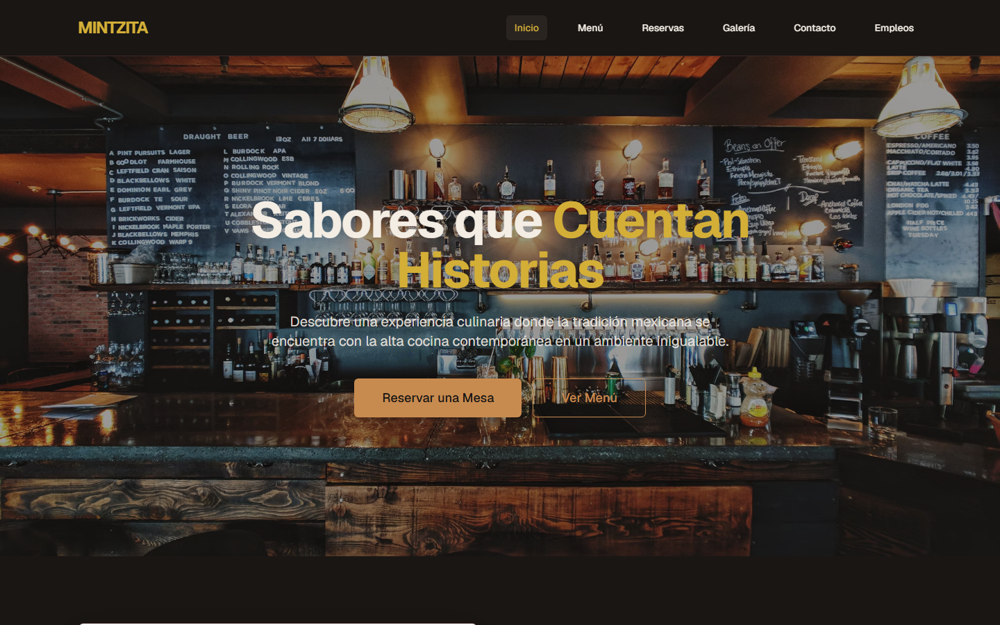
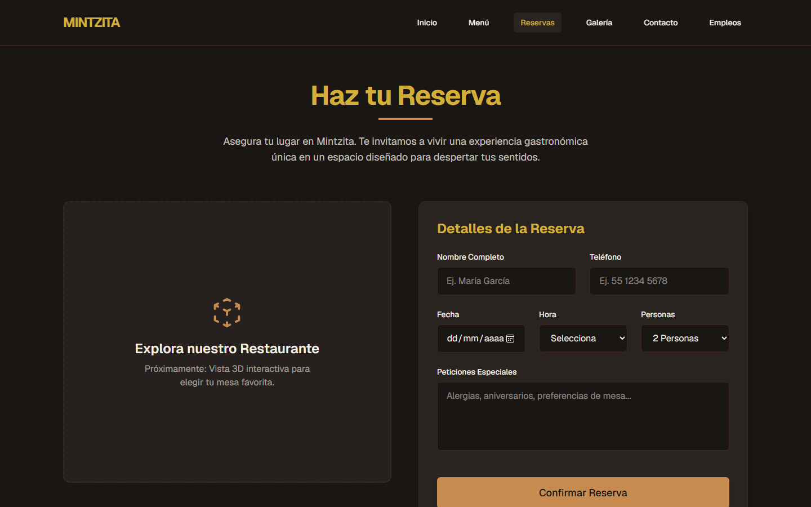
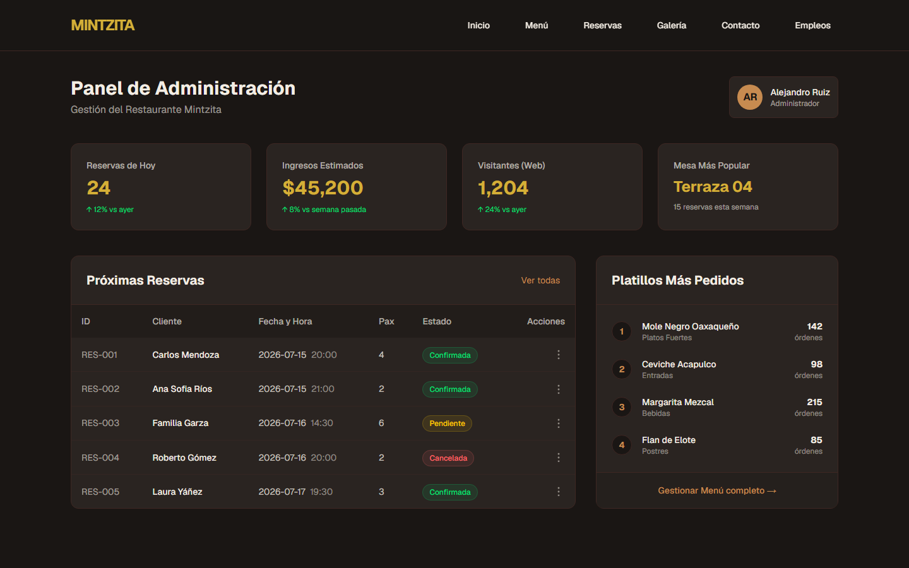

<div align="center">

# Mintzita

**A multi-page website for a contemporary Mexican restaurant: menu, table reservations, gallery, careers and an admin dashboard.**




</div>

## About

Mintzita is a front-end prototype for a fictional fine-dining restaurant in Mexico. It focuses on layout, visual identity and the user flows a real restaurant site needs. The site content is in Spanish.

> **Status:** UI prototype. Forms are not connected to a backend yet, and the admin dashboard shows sample data.

## Pages

| Route | Page | What it shows |
|---|---|---|
| `/` | Home | Hero with calls to action and a section about the chef |
| `/menu` | Menu | Dishes grouped by category (starters, mains, drinks, desserts) using a reusable `DishCard` |
| `/reservas` | Reservations | Booking form: name, phone, date, time, party size and special requests |
| `/galeria` | Gallery | Masonry-style photo grid with hover zoom |
| `/contacto` | Contact | Contact details, location placeholder, contact form and FAQ |
| `/empleos` | Careers | Open positions and a job application form |
| `/admin` | Admin | Dashboard with KPIs, upcoming reservations and most-ordered dishes |

<table>
  <tr>
    <td></td>
    <td></td>
  </tr>
  <tr>
    <td align="center"><sub>Reservations</sub></td>
    <td align="center"><sub>Admin dashboard</sub></td>
  </tr>
</table>

## Tech stack

- **Next.js 16** (App Router) with **React 19** and **TypeScript**
- **Tailwind CSS 4** with a custom brand palette defined as theme tokens in [`app/globals.css`](app/globals.css)
- Reusable components: [`Navbar`](components/Navbar.tsx), [`Footer`](components/Footer.tsx), [`Button`](components/Button.tsx) and [`DishCard`](components/DishCard.tsx)

## Getting started

You need [Node.js](https://nodejs.org) 20.9 or newer.

```bash
git clone https://github.com/GaneshaDS/Mintzita-Page.git
cd Mintzita-Page
npm install
npm run dev
```

Then open http://localhost:3000.

| Command | What it does |
|---|---|
| `npm run dev` | Development server with hot reload |
| `npm run build` | Production build |
| `npm run start` | Serves the production build |
| `npm run lint` | Runs ESLint |

## Project structure

```
app/
├── page.tsx            # Home
├── menu/page.tsx       # Menu
├── reservas/page.tsx   # Reservations
├── galeria/page.tsx    # Gallery
├── contacto/page.tsx   # Contact + FAQ
├── empleos/page.tsx    # Careers
├── admin/page.tsx      # Admin dashboard
├── layout.tsx          # Root layout (navbar, footer, fonts, metadata)
└── globals.css         # Tailwind setup and brand color tokens
components/
├── Navbar.tsx
├── Footer.tsx
├── Button.tsx
└── DishCard.tsx
```

## Roadmap

- [ ] Persist reservations and contact messages (database + API routes)
- [ ] Authentication for the admin dashboard
- [ ] Manage the menu from the admin panel
- [ ] Interactive 3D view to pick a table
- [ ] Deploy to Vercel

## Author

**Heriberto Ganesha Cortés Valdez** · [LinkedIn](https://www.linkedin.com/in/heriberto-ganesha-cort%C3%A9s-valdez-28bbb72b7/) · [ganesha.dev@outlook.com](mailto:ganesha.dev@outlook.com)

## License

Code released under the [MIT License](LICENSE). Photos are loaded from [Unsplash](https://unsplash.com) and belong to their authors.
